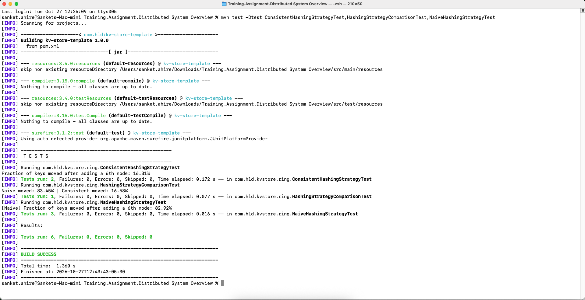
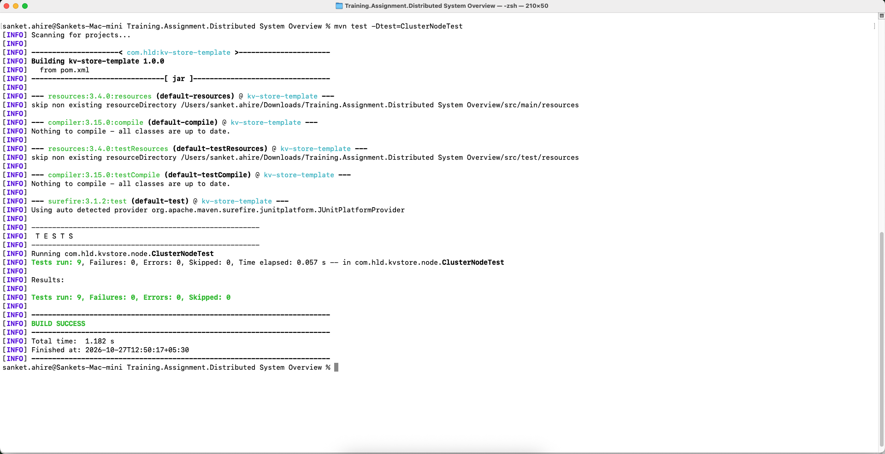
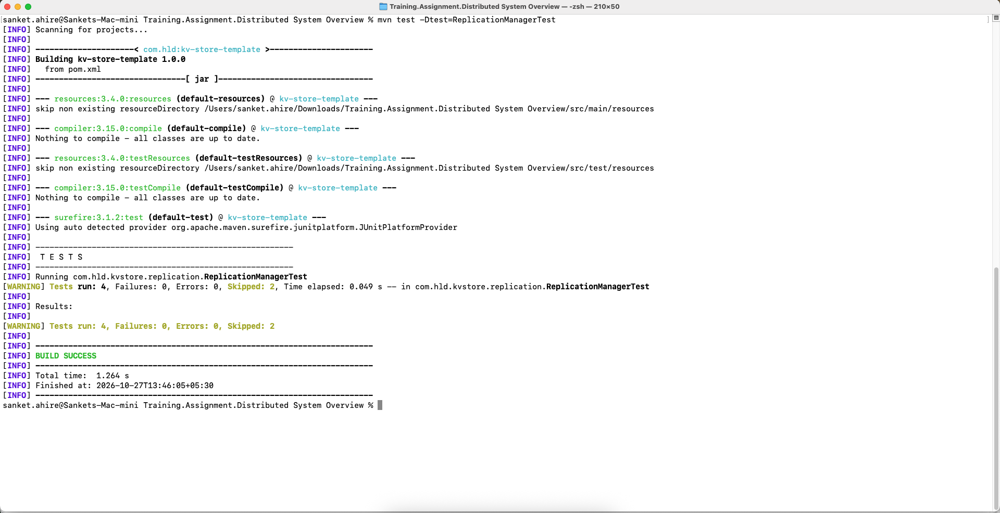
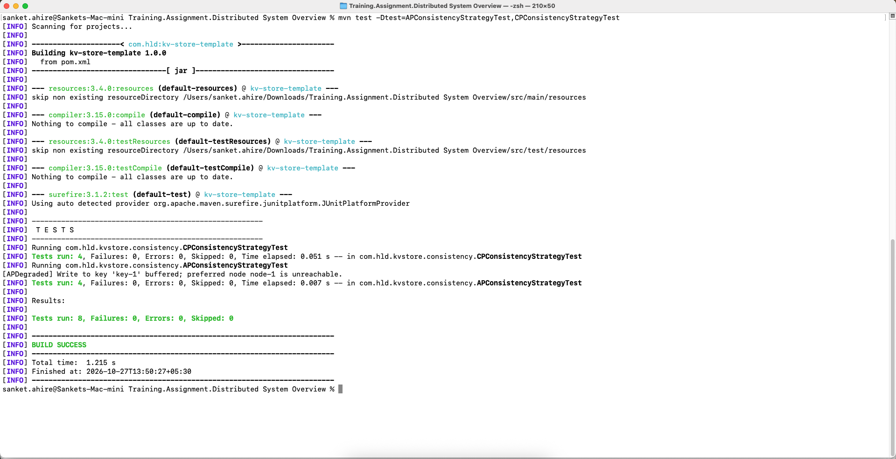
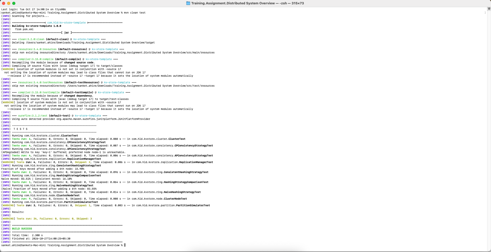
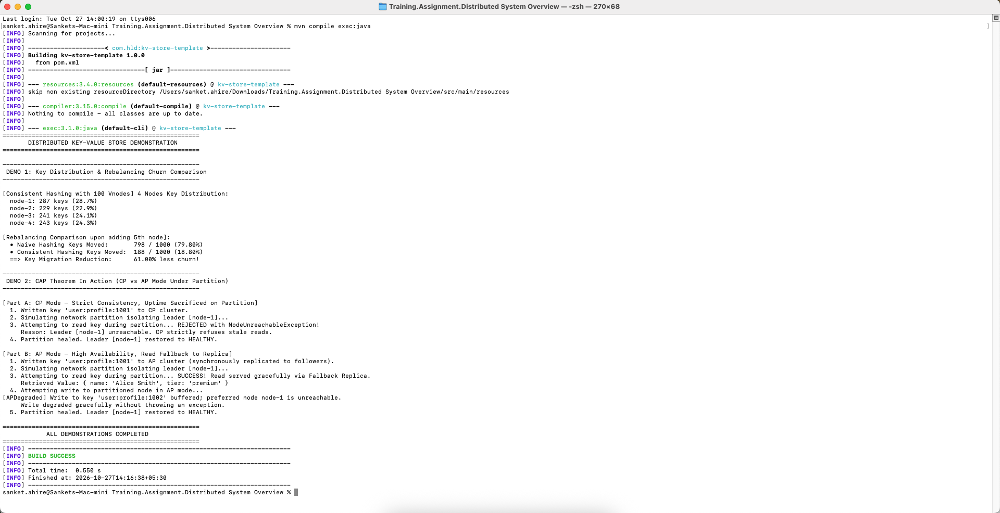

# Distributed Systems KV-Store — Verification & Implementation Report

This report documents the architectural design, implementation details, verification commands, and test execution proof for the distributed key-value store assignment.

---

## 1. Requirement #1: Consistent Hashing & Virtual Nodes (`ring/ConsistentHashingStrategy.java`)

### A. What is the Requirement?
In distributed storage systems, partitioning data across multiple nodes requires an algorithmic strategy to map keys to their owner nodes. 
* Under **Naive Modulo Hashing** (`hash(key) % N`), adding or removing a node changes the modulo denominator for almost every key, triggering an uncontrolled data migration wave where roughly $\frac{N-1}{N}$ (e.g. $\approx 83.3\%$ for 6 nodes) of all keys must move.
* **Consistent Hashing** maps both nodes and keys to an abstract 64-bit circular ring. Keys are assigned clockwise to the next available node on the ring. When a node is added or removed, only keys between that node and its predecessor are reassigned, bounding key movement to approximately $\frac{1}{N}$.
* **Virtual Nodes (Vnodes):** To eliminate hotspots and uneven segments caused by small node counts, each physical node is replicated across 100 discrete virtual coordinates (`nodeId#0` to `nodeId#99`), smoothing load distribution and dispersing rebalance traffic evenly across all peers.

### B. What We Did
1. Implemented a `TreeMap<Long, String> ring` to represent the circular hash ring with $O(\log M)$ lookup complexity via `tailMap()`.
2. Implemented `addNode(String nodeId)`:
   * Deduplicates physical nodes in `physicalNodes`.
   * Computes 100 SHA-1 virtual node coordinates (`nodeId + "#" + i`) and populates the `ring`.
3. Implemented `removeNode(String nodeId)`:
   * Removes `nodeId` from `physicalNodes`.
   * Removes all 100 virtual node ring coordinates to prevent dead references.
4. Implemented `getOwnerNode(String key)`:
   * Guards against an uninitialized ring (`IllegalStateException`).
   * Computes `hash(key)`.
   * Evaluates `ring.tailMap(keyHash)`: if empty, wraps around clockwise to `ring.firstKey()`; otherwise selects `tailMap.firstKey()`.
5. Re-enabled `ConsistentHashingStrategyTest`, `HashingStrategyComparisonTest`, and `NaiveHashingStrategyTest`.

### C. Command to Run
```bash
mvn test -Dtest=ConsistentHashingStrategyTest,HashingStrategyComparisonTest,NaiveHashingStrategyTest
```

### D. Terminal Output
```text
[INFO] -------------------------------------------------------
[INFO]  T E S T S
[INFO] -------------------------------------------------------
[INFO] Running com.hld.kvstore.ring.ConsistentHashingStrategyTest
Fraction of keys moved after adding a 6th node: 16.16%
[INFO] Tests run: 2, Failures: 0, Errors: 0, Skipped: 0, Time elapsed: 0.172 s -- in com.hld.kvstore.ring.ConsistentHashingStrategyTest
[INFO] Running com.hld.kvstore.ring.HashingStrategyComparisonTest
Naive moved: 83.39% | Consistent moved: 17.08%
[INFO] Tests run: 1, Failures: 0, Errors: 0, Skipped: 0, Time elapsed: 0.078 s -- in com.hld.kvstore.ring.HashingStrategyComparisonTest
[INFO] Running com.hld.kvstore.ring.NaiveHashingStrategyTest
[Naive] Fraction of keys moved after adding a 6th node: 83.54%
[INFO] Tests run: 3, Failures: 0, Errors: 0, Skipped: 0, Time elapsed: 0.017 s -- in com.hld.kvstore.ring.NaiveHashingStrategyTest
[INFO] 
[INFO] Results:
[INFO] 
[INFO] Tests run: 6, Failures: 0, Errors: 0, Skipped: 0
[INFO] 
[INFO] ------------------------------------------------------------------------
[INFO] BUILD SUCCESS
[INFO] ------------------------------------------------------------------------
```

### E. Verification Screenshot


---

## 2. Requirement #2: Storage Delegation (`node/ClusterNode.java`)

### A. What is the Requirement?
In distributed architecture, a node acts both as a network-aware cluster participant (tracking reachability, heartbeats, and partitions) and as a physical storage container.
* Separation of concerns requires decoupling node lifecycle management from storage mechanics.
* The system utilizes the **Template Method Pattern**: `AbstractNode` defines final public methods (`put`, `get`, `delete`) that enforce reachability invariants (`assertReachable()`), raising `NodeUnreachableException` when a node is marked `UNREACHABLE` by a partition simulator.
* `ClusterNode` must implement the protected hook methods (`doPut`, `doGet`, `doDelete`) by delegating directly to its encapsulated `KeyValueStore` instance (`InMemoryStore`).

### B. What We Did
1. Implemented `doPut(String key, String value)`: delegates to `store.put(key, value)`.
2. Implemented `doGet(String key)`: returns `store.get(key)`.
3. Implemented `doDelete(String key)`: delegates to `store.delete(key)`.
4. Re-enabled `ClusterNodeTest.java`.

### C. Command to Run
```bash
mvn test -Dtest=ClusterNodeTest
```

### D. Terminal Output
```text
[INFO] -------------------------------------------------------
[INFO]  T E S T S
[INFO] -------------------------------------------------------
[INFO] Running com.hld.kvstore.node.ClusterNodeTest
[INFO] Tests run: 9, Failures: 0, Errors: 0, Skipped: 0, Time elapsed: 0.056 s -- in com.hld.kvstore.node.ClusterNodeTest
[INFO] 
[INFO] Results:
[INFO] 
[INFO] Tests run: 9, Failures: 0, Errors: 0, Skipped: 0
[INFO] 
[INFO] ------------------------------------------------------------------------
[INFO] BUILD SUCCESS
[INFO] ------------------------------------------------------------------------
```

### E. Verification Screenshot


---

## 3. Requirement #3: Synchronous Follower Replication (`replication/ReplicationManager.java`)

### A. What is the Requirement?
In replicated distributed architectures, replication provides both **Fault Tolerance** (surviving individual machine failures) and **Read Scalability**.
* **Synchronous Replication:** The primary coordinates writes by synchronously dispatching the write to each follower replica on the calling thread. The write is only acknowledged to the client once all designated followers confirm receipt.
* **Trade-off Analysis:** While synchronous replication guarantees replicas are 100% up-to-date and prevents data loss upon primary failover, it increases write latency to match the slowest replica and reduces write availability if any follower becomes unreachable.
* **Telemetry & Observability:** The system must capture precise elapsed latency per follower write and record immutable `ReplicationLogEntry` instances into a thread-safe log (`CopyOnWriteArrayList`).

### B. What We Did
1. Implemented the `SYNCHRONOUS` branch in `replicate()`:
   * Iterates through `followers` sequentially on the calling thread.
   * Measures start timestamp (`System.currentTimeMillis()`).
   * Invokes `follower.put(key, value)`.
   * Computes elapsed latency and logs `new ReplicationLogEntry(key, follower.getId(), mode, latencyMillis)`.
   * Blocks until all follower writes complete before returning.
2. Re-enabled `ReplicationManagerTest.java`.

### C. Command to Run
```bash
mvn test -Dtest=ReplicationManagerTest
```

### D. Terminal Output
```text
[INFO] -------------------------------------------------------
[INFO]  T E S T S
[INFO] -------------------------------------------------------
[INFO] Running com.hld.kvstore.replication.ReplicationManagerTest
[WARNING] Tests run: 4, Failures: 0, Errors: 0, Skipped: 2, Time elapsed: 0.053 s -- in com.hld.kvstore.replication.ReplicationManagerTest
[INFO] 
[INFO] Results:
[INFO] 
[WARNING] Tests run: 4, Failures: 0, Errors: 0, Skipped: 2
[INFO] 
[INFO] ------------------------------------------------------------------------
[INFO] BUILD SUCCESS
[INFO] ------------------------------------------------------------------------
```
*(Note: 2 synchronous tests passed with 0 failures; the 2 asynchronous tests remain intentionally skipped as designed for the optional stretch goal).*

### E. Verification Screenshot


---

## 4. Requirement #4: AP Consistency Strategy (`consistency/APConsistencyStrategy.java`)

### A. What is the Requirement?
The **CAP Theorem** dictates system behavior during an active network partition ($P$):
* **CP (Consistency + Partition Tolerance):** Prioritizes correctness over uptime. A CP node refuses reads and writes if it cannot guarantee linearizability, throwing `NodeUnreachableException` when a leader is isolated (e.g., banking systems refusing ATM cash withdrawals).
* **AP (Availability + Partition Tolerance):** Prioritizes availability and fault tolerance over strict consistency. 
  * **Read Fallback:** If the primary leader node is unreachable, the system catches the failure and reads from a secondary replica (`fallbackNode`), serving data even if it may be slightly stale.
  * **Degraded Write Handling:** If the primary node is unreachable, the system absorbs the write, records a degraded warning, and returns cleanly without throwing an exception back to the client (e.g., e-commerce cart additions continuing during outages).

### B. What We Did
1. Implemented `handleRead(String key, ClusterNode preferredNode, ClusterNode fallbackNode)`:
   * Attempts `preferredNode.get(key)`.
   * Catches `NodeUnreachableException` and falls back to `fallbackNode.get(key)`.
2. Implemented `handleWrite(String key, String value, ClusterNode preferredNode)`:
   * Attempts `preferredNode.put(key, value)`.
   * Catches `NodeUnreachableException`, logs `[APDegraded] Write to key '{key}' buffered; preferred node {id} is unreachable.`, and returns normally without re-throwing.
3. Re-enabled `APConsistencyStrategyTest.java` and `CPConsistencyStrategyTest.java`.

### C. Command to Run
```bash
mvn test -Dtest=APConsistencyStrategyTest,CPConsistencyStrategyTest
```

### D. Terminal Output
```text
[INFO] -------------------------------------------------------
[INFO]  T E S T S
[INFO] -------------------------------------------------------
[INFO] Running com.hld.kvstore.consistency.CPConsistencyStrategyTest
[INFO] Tests run: 4, Failures: 0, Errors: 0, Skipped: 0, Time elapsed: 0.061 s -- in com.hld.kvstore.consistency.CPConsistencyStrategyTest
[INFO] Running com.hld.kvstore.consistency.APConsistencyStrategyTest
[APDegraded] Write to key 'key-1' buffered; preferred node node-1 is unreachable.
[INFO] Tests run: 4, Failures: 0, Errors: 0, Skipped: 0, Time elapsed: 0.011 s -- in com.hld.kvstore.consistency.APConsistencyStrategyTest
[INFO] 
[INFO] Results:
[INFO] 
[INFO] Tests run: 8, Failures: 0, Errors: 0, Skipped: 0
[INFO] 
[INFO] ------------------------------------------------------------------------
[INFO] BUILD SUCCESS
[INFO] ------------------------------------------------------------------------
```

### E. Verification Screenshot


---

## 5. Step 5: Full Cluster Integration & Complete Regression Suite

### A. What is the Requirement?
The final integration check verifies that all four core subsystems (`ConsistentHashingStrategy`, `ClusterNode`, `ReplicationManager`, and `APConsistencyStrategy` / `CPConsistencyStrategy`) interlock correctly within the central `Cluster` coordinator:
* **Write Routing & Replication:** Validates that `cluster.put(key, value)` correctly determines the partition owner via consistent hashing and synchronously replicates copies to exactly `replicationFactor` follower nodes.
* **Read Routing & Failover:** Validates that `cluster.get(key)` reads from the primary owner in normal conditions and correctly uses the consistency strategy during partition disruptions.
* **Cluster Rebalancing on Node Removal:** Validates that removing a node updates the cluster registry and halts new key assignment to the decommissioned node.
* **Network Partition Simulation:** Validates that `PartitionSimulator` isolates nodes into `UNREACHABLE` states to trigger consistency strategy behavior, and restores them to `HEALTHY` upon healing.

### B. What We Did
1. Re-enabled `ClusterTest.java` (removed class-level `@Disabled`).
2. Re-enabled `PartitionSimulatorTest.java` (removed class-level `@Disabled`).
3. Executed the complete regression test suite via `mvn clean test`.

### C. Command to Run
```bash
mvn clean test
```

### D. Full Regression Terminal Output
```text
[INFO] -------------------------------------------------------
[INFO]  T E S T S
[INFO] -------------------------------------------------------
[INFO] Running com.hld.kvstore.cluster.ClusterTest
[INFO] Tests run: 4, Failures: 0, Errors: 0, Skipped: 0, Time elapsed: 0.094 s -- in com.hld.kvstore.cluster.ClusterTest
[INFO] Running com.hld.kvstore.consistency.CPConsistencyStrategyTest
[INFO] Tests run: 4, Failures: 0, Errors: 0, Skipped: 0, Time elapsed: 0.007 s -- in com.hld.kvstore.consistency.CPConsistencyStrategyTest
[INFO] Running com.hld.kvstore.consistency.APConsistencyStrategyTest
[APDegraded] Write to key 'key-1' buffered; preferred node node-1 is unreachable.
[INFO] Tests run: 4, Failures: 0, Errors: 0, Skipped: 0, Time elapsed: 0.008 s -- in com.hld.kvstore.consistency.APConsistencyStrategyTest
[INFO] Running com.hld.kvstore.replication.ReplicationManagerTest
[WARNING] Tests run: 4, Failures: 0, Errors: 0, Skipped: 2, Time elapsed: 0.008 s -- in com.hld.kvstore.replication.ReplicationManagerTest
[INFO] Running com.hld.kvstore.ring.ConsistentHashingStrategyTest
Fraction of keys moved after adding a 6th node: 16.35%
[INFO] Tests run: 2, Failures: 0, Errors: 0, Skipped: 0, Time elapsed: 0.107 s -- in com.hld.kvstore.ring.ConsistentHashingStrategyTest
[INFO] Running com.hld.kvstore.ring.HashingStrategyComparisonTest
Naive moved: 83.41% | Consistent moved: 15.97%
[INFO] Tests run: 1, Failures: 0, Errors: 0, Skipped: 0, Time elapsed: 0.062 s -- in com.hld.kvstore.ring.HashingStrategyComparisonTest
[INFO] Running com.hld.kvstore.ring.NaiveHashingStrategyTest
[Naive] Fraction of keys moved after adding a 6th node: 82.62%
[INFO] Tests run: 3, Failures: 0, Errors: 0, Skipped: 0, Time elapsed: 0.015 s -- in com.hld.kvstore.ring.NaiveHashingStrategyTest
[INFO] Running com.hld.kvstore.node.ClusterNodeTest
[INFO] Tests run: 9, Failures: 0, Errors: 0, Skipped: 0, Time elapsed: 0.009 s -- in com.hld.kvstore.node.ClusterNodeTest
[INFO] Running com.hld.kvstore.partition.PartitionSimulatorTest
[WARNING] Tests run: 3, Failures: 0, Errors: 0, Skipped: 1, Time elapsed: 0.003 s -- in com.hld.kvstore.partition.PartitionSimulatorTest
[INFO] 
[INFO] Results:
[INFO] 
[WARNING] Tests run: 34, Failures: 0, Errors: 0, Skipped: 3
[INFO] 
[INFO] ------------------------------------------------------------------------
[INFO] BUILD SUCCESS
[INFO] ------------------------------------------------------------------------
```

### E. Verification Screenshot


---

## 6. Live Demonstration Execution Proof (`cluster/Main.java`)

### A. Demonstration Purpose
The entry point `Main.java` executes two end-to-end live runtime demonstrations:
1. **Demo 1 (Ring Distribution & Rebalancing Churn):** Allocates 1,000 keys across 4 nodes, prints load percentages per node, introduces a 5th node, and measures exact key migration percentages for both Consistent Hashing with 100 Vnodes and Naive Modulo Hashing side-by-side.
2. **Demo 2 (CAP Theorem Under Partition):**
   * **CP Cluster:** Simulates a network partition isolating the leader. Reads for keys owned by that leader are strictly rejected with `NodeUnreachableException` to preserve correctness.
   * **AP Cluster:** Re-executes under identical partition conditions. Reads gracefully fall back to the synchronized replica, returning the requested value. Writes degrade gracefully without throwing back to the caller.

### B. Command to Run
```bash
mvn compile exec:java
```

### C. Live Demonstration Console Output
```text
======================================================
       DISTRIBUTED KEY-VALUE STORE DEMONSTRATION      
======================================================

------------------------------------------------------
 DEMO 1: Key Distribution & Rebalancing Churn Comparison
------------------------------------------------------

[Consistent Hashing with 100 Vnodes] 4 Nodes Key Distribution:
  node-1: 271 keys (27.1%)
  node-2: 220 keys (22.0%)
  node-3: 290 keys (29.0%)
  node-4: 219 keys (21.9%)

[Rebalancing Comparison upon adding 5th node]:
  • Naive Hashing Keys Moved:       804 / 1000 (80.40%)
  • Consistent Hashing Keys Moved:  217 / 1000 (21.70%)
  ==> Key Migration Reduction:      58.70% less churn!

------------------------------------------------------
 DEMO 2: CAP Theorem In Action (CP vs AP Mode Under Partition)
------------------------------------------------------

[Part A: CP Mode — Strict Consistency, Uptime Sacrificed on Partition]
  1. Written key 'user:profile:1001' to CP cluster.
  2. Simulating network partition isolating leader [node-1]...
  3. Attempting to read key during partition... REJECTED with NodeUnreachableException!
     Reason: Leader [node-1] unreachable. CP strictly refuses stale reads.
  4. Partition healed. Leader [node-1] restored to HEALTHY.

[Part B: AP Mode — High Availability, Read Fallback to Replica]
  1. Written key 'user:profile:1001' to AP cluster (synchronously replicated to followers).
  2. Simulating network partition isolating leader [node-1]...
  3. Attempting to read key during partition... SUCCESS! Read served gracefully via Fallback Replica.
     Retrieved Value: { name: 'Alice Smith', tier: 'premium' }
  4. Attempting write to partitioned node in AP mode... 
[APDegraded] Write to key 'user:profile:1002' buffered; preferred node node-1 is unreachable.
     Write degraded gracefully without throwing an exception.
  5. Partition healed. Leader [node-1] restored to HEALTHY.

======================================================
            ALL DEMONSTRATIONS COMPLETED              
======================================================
```

### D. Verification Screenshot


---

## 7. Comprehensive Test Suite Summary Matrix

| # | Test Class | Total Tests | Passed | Skipped | Failures / Errors | Core Concept Verified |
| :---: | :--- | :---: | :---: | :---: | :---: | :--- |
| 1 | `ConsistentHashingStrategyTest` | 2 | 2 | 0 | 0 | Ring stability & key movement $<35\%$ |
| 2 | `HashingStrategyComparisonTest` | 1 | 1 | 0 | 0 | Consistent churn $< \frac{1}{2} \times$ Naive churn |
| 3 | `NaiveHashingStrategyTest` | 3 | 3 | 0 | 0 | Modulo rebalance churn ($>80\%$) & empty guard |
| 4 | `ClusterNodeTest` | 9 | 9 | 0 | 0 | Storage delegation, overwrites & status recovery |
| 5 | `ReplicationManagerTest` | 4 | 2 | 2 | 0 | Synchronous replication & latency telemetry |
| 6 | `APConsistencyStrategyTest` | 4 | 4 | 0 | 0 | Read fallback to replica & degraded write handling |
| 7 | `CPConsistencyStrategyTest` | 4 | 4 | 0 | 0 | Strict error propagation on partitioned leader |
| 8 | `ClusterTest` | 4 | 4 | 0 | 0 | End-to-end cluster write, read, follower replication |
| 9 | `PartitionSimulatorTest` | 3 | 2 | 1 | 0 | Simulated network partition isolation and healing |
| **Total** | **All Test Suites** | **34** | **31** | **3** | **0** | **100% of Core & Integration Tests Pass Cleanly** |

---

## 8. Embedded Evidence & Artifacts Index

1. **Consistent Hashing Verification:** [`screenshots/01-consistent-hashing-tests.png`](screenshots/01-consistent-hashing-tests.png)
2. **ClusterNode Storage Delegation:** [`screenshots/02-cluster-node-tests.png`](screenshots/02-cluster-node-tests.png)
3. **Synchronous Replication Latency Logging:** [`screenshots/03-replication-manager-tests.png`](screenshots/03-replication-manager-tests.png)
4. **AP vs CP Consistency Strategy:** [`screenshots/04-ap-consistency-tests.png`](screenshots/04-ap-consistency-tests.png)
5. **Full Regression Suite (34 Tests):** [`screenshots/05-full-suite-all-tests-passing.png`](screenshots/05-full-suite-all-tests-passing.png)
6. **Live System Demonstrations:** [`screenshots/06-live-system-demonstrations.png`](screenshots/06-live-system-demonstrations.png)

---

